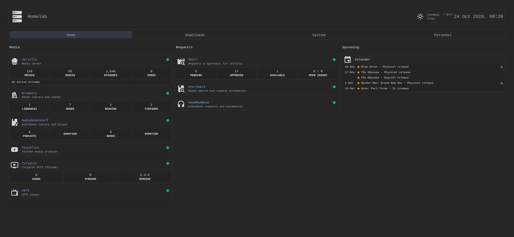
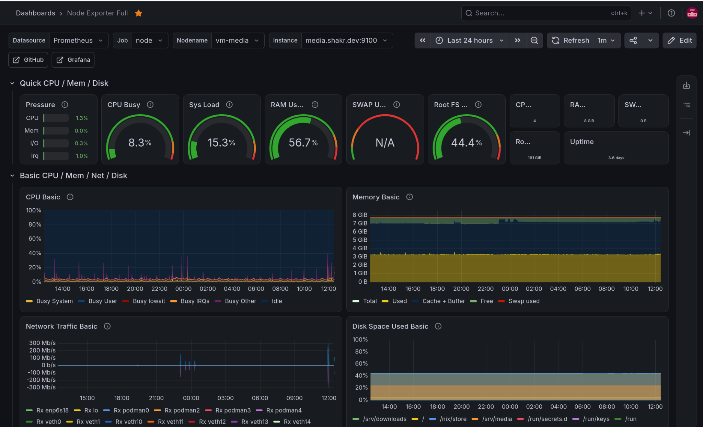

# homelab-nix

**A declarative NixOS homelab on Proxmox, provisioned with OpenTofu and deployed with Colmena.**

Eight role-based NixOS VMs run networking, media, storage, home automation, personal applications, observability, CI and releases. Host configuration lives in a single Nix flake, with Podman and native NixOS services, sops-nix for secrets and Renovate for dependency updates.



## Architecture

OpenTofu provisions the guests on Proxmox and manages the MikroTik router's network policy; NixOS modules define VM configuration, and Colmena deploys changes over SSH. Each host combines shared defaults with a role-specific profile.

<!-- Diagram source: docs/assets/architecture.mmd -->
<p align="center">
  
</p>

*Simplified service architecture, not a full network topology.* MikroTik handles inter-VLAN routing and default-deny firewall policy; `vm-gw` handles DNS, reverse proxying and Tailscale access.

| VM | Role | Representative services |
| --- | --- | --- |
| [`vm-gw`](nix/hosts/vm-gw/default.nix) | DNS, ingress, remote access | AdGuard, Unbound, Caddy, Tailscale, Homepage |
| [`vm-media`](nix/hosts/vm-media/default.nix) | Media and automation | Jellyfin, Sonarr, Radarr, qBittorrent, Audiobookshelf |
| [`vm-storage`](nix/hosts/vm-storage/default.nix) | Shared bulk storage | mergerfs, NFS |
| [`vm-apps`](nix/hosts/vm-apps/default.nix) | Home automation and personal apps | Home Assistant, Obsidian Livesync, Yamtrack, Kaneo |
| [`vm-sensitive`](nix/hosts/vm-sensitive/default.nix) | Personal and financial apps | Actual Budget, Standard Notes, InvoicePlane, Vaultwarden |
| [`vm-monitoring`](nix/hosts/vm-monitoring/default.nix) | Metrics, logs, probes, alerting | Prometheus, Grafana, Loki, Alertmanager |
| [`vm-ci`](nix/hosts/vm-ci/default.nix) | Isolated CI | Three ephemeral GitHub Actions runners, rootless Docker |
| [`vm-release`](nix/hosts/vm-release/default.nix) | Isolated releases | One ephemeral runner for a separate release repository: builds, publishes and deploys production images |

Each [host](nix/hosts) combines the base profile with role [profiles](nix/profiles), which group [service modules](nix/services), and individual service modules where needed. Every VM imports the shared Node Exporter and Alloy modules via the [base profile](nix/profiles/base/default.nix); `vm-ci` and `vm-release` keep their logs local because Loki is not reachable from VLANs 30 and 31.

## Network

The MikroTik separates personal devices, NixOS servers, CI, releases and IoT equipment into five zones:

| Zone | VLAN | Devices |
| --- | --- | --- |
| TRUSTED | 1 | Personal devices and Proxmox management |
| SERVERS | 20 | NixOS VMs |
| CI | 30 | `vm-ci`; egress to the internet only |
| RELEASE | 31 | `vm-release`; egress to the internet only, separate from CI |
| IOT | 40 | Smart-home devices, TVs and the Reolink hub |

New cross-zone connections are denied unless a firewall rule explicitly permits them. IoT clients also have dedicated DNS policy and Wi-Fi client isolation. Router configuration lives primarily in [`infra/router/`](infra/router); the [network guide](docs/network.md) covers allowed traffic, configuration ownership and change safety.

## Interesting implementations

This is my own infrastructure rather than a reusable installer but several components may be useful independently:

| Area | Implementation | Why it's worth a look |
| --- | --- | --- |
| Network segmentation | [`infra/router/`](infra/router) | VLANs, zone firewall, RouterOS OpenTofu and router-local rollback |
| Provisioning and deployment | [`infra/proxmox/vms.tf`](infra/proxmox/vms.tf) · [`flake.nix`](flake.nix) | Proxmox VM definitions alongside eight NixOS configurations and a Colmena hive |
| Role-based modules | [`nix/profiles/`](nix/profiles) | Shared defaults separated from application-specific roles |
| Service discovery | [`records.nix`](nix/modules/dns/records.nix) | Common DNS and reverse-proxy host definitions |
| Runtime secrets | [`templates.nix`](nix/modules/secrets/templates.nix) | sops-nix secrets rendered into environment files with dependent service restarts |
| Self-hosted CI | [`ci-runner/default.nix`](nix/services/ci-runner/default.nix) | Ephemeral runners in containers under rootless Docker, on VLANs that can only open connections to the internet; pull requests and releases run on separate VMs |
| Monitoring the monitor | [`heartbeat/default.nix`](nix/services/monitoring/heartbeat/default.nix) | A systemd timer only sends an external heartbeat when local alerting checks pass |
| Storage and passthrough | [`mergerfs/default.nix`](nix/services/mergerfs/default.nix) · [`pci.tf`](infra/proxmox/pci.tf) | Pooled media storage and Intel iGPU passthrough to the media VM |
| Home Assistant configuration | [`home-assistant/default.nix`](nix/services/home-assistant/default.nix) | Declarative configuration validated before activation |

## Observability

Prometheus scrapes NixOS and Proxmox metrics; Blackbox Exporter checks HTTP service availability; and Grafana Alloy forwards host logs to Loki. RouterOS syslog provides firewall and network events. Alertmanager sends Telegram notifications. A separate, health-gated external heartbeat helps detect failures in the local monitoring and alerting pipeline.



See the [monitoring modules](nix/services/monitoring) for exporters, probes, alert rules, logs, and dashboards.

## Repository layout

```text
.
├── flake.nix       # NixOS hosts, Colmena hive, Proxmox template
├── infra/
│   ├── proxmox/    # OpenTofu: Proxmox VMs
│   └── router/     # OpenTofu: MikroTik network
├── nix/
│   ├── hosts/      # Per-VM settings
│   ├── profiles/   # Shared defaults and role-specific composition
│   ├── modules/    # Reusable NixOS options
│   └── services/   # Applications and observability
├── docs/           # Network and backup guides, dashboard screenshots
├── secrets/        # Encrypted SOPS files
├── templates/      # Proxmox NixOS template definition
├── Makefile        # Provisioning and deployment shortcuts
└── renovate.json   # Automated dependency updates
```

## Exploring and adapting

This is a personal, hardware-specific configuration, not a plug-and-play installer. To explore the flake outputs without deploying anything:

```bash
git clone https://github.com/shakirware/homelab-nix.git
cd homelab-nix
nix flake show
nix eval --raw .#nixosConfigurations.vm-gw.config.networking.hostName
```

Before reusing it, review the [OpenTofu configuration](infra), host interfaces and disk identifiers, internal addresses and domains, SSH settings, and SOPS recipients. The encrypted secrets belong to this installation and cannot be decrypted with unrelated keys.

<details>
<summary>Deployment commands used in this homelab</summary>

```bash
# Build the guest template on a suitable Linux builder
nix build .#proxmox-template

# Review and apply Proxmox infrastructure changes
make plan
make apply            # Modifies Proxmox resources

# Review and apply router changes (requires a checked rollback for access changes)
make router-plan
make router-apply

# Reconfigure an individual guest or all guests
make deploy-gw
make deploy-monitoring
make deploy-all       # Changes running NixOS systems
```

Provisioning requires OpenTofu and Proxmox credentials; access-affecting router changes require a [router-local rollback](docs/network.md#change-safety); deployments require working Colmena SSH access and appropriate SOPS decryption keys. Do not run these commands unchanged against your own environment. See the [`Makefile`](Makefile) for other targets.

</details>

## Hardware

The lab runs on a single server built mostly from second-hand components, balancing cost, noise and power use.

| Component | Hardware |
| --- | --- |
| CPU | Intel Core i3-8100; iGPU passed through to `vm-media` |
| Memory | 48 GB DDR4 (3 × 16 GB) |
| Motherboard | ASUS PRIME H370-A |
| Boot / VM storage | 512 GB NVMe SSD |
| Bulk storage | 2 × 16 TB Seagate IronWolf Pro HDDs |
| Case / PSU | Fractal Design Define R5 / Seasonic Focus GX-750 |
| Router | MikroTik hAP ax2 |
| Observed idle | Approximately 32 W |

The current NIC limits deeper CPU C-states; a different NIC might reduce idle consumption.

## Trade-offs

- **Storage resilience.** mergerfs combines drives without redundancy or parity, and media is not backed up. Application data is backed up nightly to `vm-storage` and Backblaze B2 ([backup guide](docs/backups.md)), but there are no whole-VM Proxmox backups; a disk failure can still lose media.
- **Management boundaries.** OpenTofu manages most MikroTik settings, but bootstrap, accounts and selected existing settings are manual. Proxmox host configuration and hardening are also separate.
- **Shared CI host.** Self-hosted runners (`vm-ci` and `vm-release`) save hosted CI minutes but share the single host's CPU with production; a low scheduling priority favours production workloads during CPU contention, at the cost of slower CI.
- **This is site-specific.** Disk mappings, IP addresses, hardware passthrough, and secrets require adaptation.

## Roadmap

- [x] Automated off-site backups of application data with tested restores ([backup guide](docs/backups.md)).
- [ ] Add storage redundancy for the media pool.
- [ ] Deploy Immich for photo management once the storage and backup setup is ready.
- [ ] Deploy Paperless-ngx for document management.
- [x] Deploy Vaultwarden for password management.
- [ ] Evaluate Copyparty for file sharing.
- [ ] Add automated Nix/OpenTofu checks.

## Feedback

This is a personal homelab shared as a technical reference. If you have suggestions for NixOS modules, Proxmox provisioning, storage or monitoring, feel free to [open an issue](https://github.com/shakirware/homelab-nix/issues).
